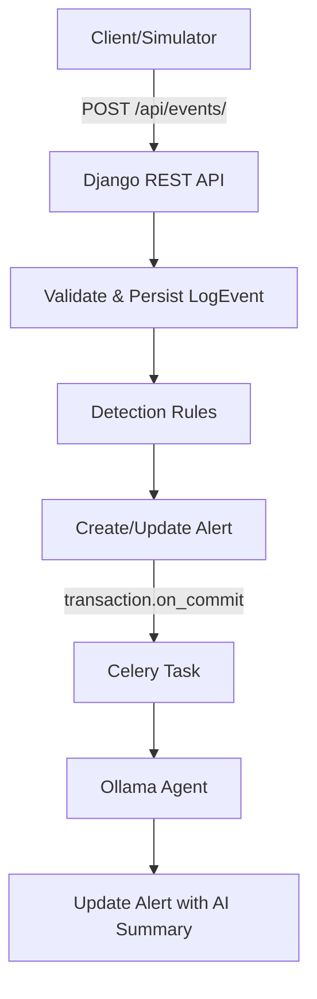

# AI-Assisted Intrusion Monitoring Backend — Minimal MVP

This is an AI-assisted intrusion investigation backend prototype. It detects two configured patterns (brute force, port scan); it does not discover arbitrary unknown attacks and is not a production SIEM/IDS.

## Architecture

## Setup

See docker-compose.yml for local setup.

## Limitations
- Two rules only
- One latest window per IP per batch
- Local model quality varies
- UI is Django Admin/API only
- No ML or automatic response
- No automatic worker-crash sweeper
- Hard worker crash may leave status running until manual re-run
