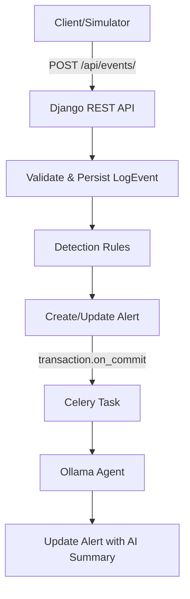

# AI-Assisted Intrusion Monitoring Backend — Minimal MVP

This is an AI-assisted intrusion investigation backend prototype. It detects two configured patterns (brute force, port scan); it does not discover arbitrary unknown attacks and is not a production SIEM/IDS.

## Architecture

## Setup

1. `cp .env.example .env` and edit secrets
2. `make up`
3. `make users`
4. `make demo`

## Tests

`make test`

## Running Ollama

Run Ollama on the host and set `OLLAMA_HOST`. Set `OLLAMA_MODEL` as needed.

## API Endpoints
- `GET /api/health/`
- `POST /api/events/`
- `GET /api/alerts/`
- `GET /api/alerts/{id}/`
- `PATCH /api/alerts/{id}/` (incident_status only)

## Detection
- Brute force: >= 20 failed logins in 60s sliding window (high)
- Port scan: >= 15 distinct destination ports in 60s sliding window (medium)
- Sliding window anchored at latest event time in submitted batch

## Agent
- One tool `get_related_context` (read-only, scoped to alert). 
- At most 2 LLM calls + 1 tool call per attempt, 1 retry for transient errors.
- Only `summary` and `recommended_actions` are stored; severity/evidence unchanged by LLM.

## Limitations
- Two rules only
- One latest window per IP per batch
- Local model quality varies
- UI is Django Admin/API only
- No ML or automatic response
- No automatic worker-crash sweeper
- Hard worker crash may leave status `running` until manual re-run (use Admin re-run action)
- Single-worker investigation queue can build up during alert storms
- Redis used only as Celery broker
- Dev server and token auth not production-grade
