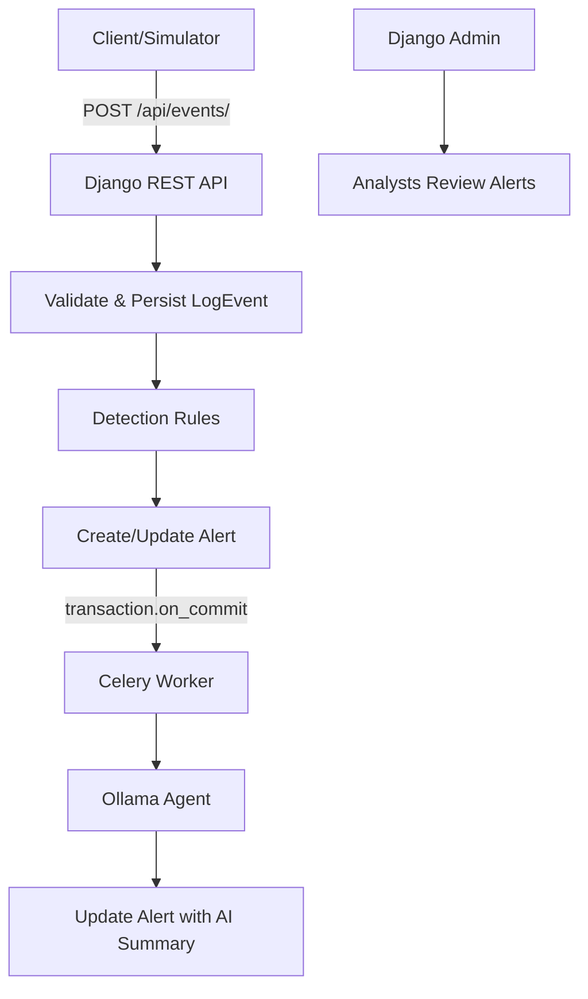
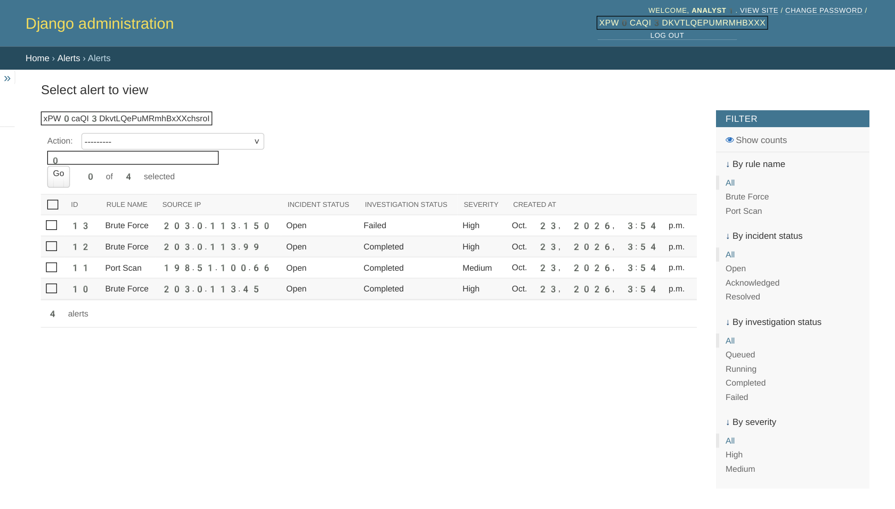
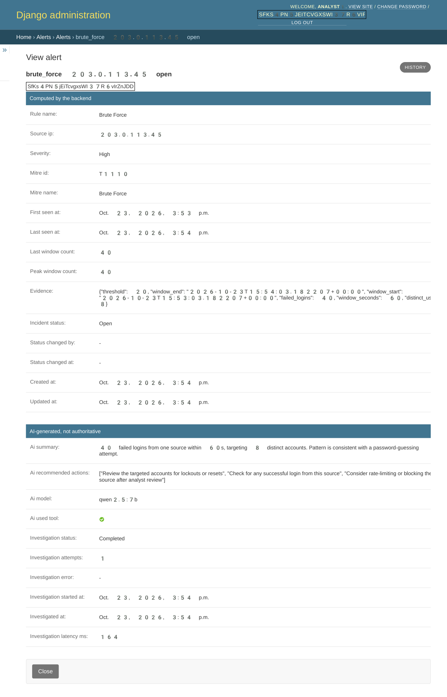
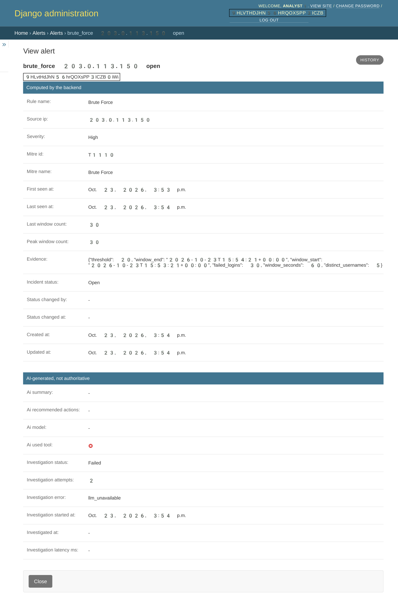

# AI-Assisted Intrusion Monitoring Backend

[](https://www.python.org/)
[](https://www.djangoproject.com/)
[](https://www.django-rest-framework.org/)
[](https://www.postgresql.org/)
[](https://docs.celeryq.dev/)
[](https://redis.io/)
[](https://ollama.com/)

> A minimal MVP demonstrating event ingestion, rule-based intrusion detection, and AI-assisted investigation with a tool-using agent, asynchronous workers, and Django Admin. Built with security hardening in mind.

## Table of Contents

- [Overview](#overview)
- [Key Features](#key-features)
- [Architecture](#architecture)
- [Screenshots](#screenshots)
- [Tech Stack](#tech-stack)
- [Quick Start (Docker)](#quick-start-docker)
- [Demo Without a Real LLM](#demo-without-a-real-llm)
- [Usage](#usage)
- [API Endpoints](#api-endpoints)
- [Agent Behavior](#agent-behavior)
- [Detection Rules](#detection-rules)
- [Security & Hardening](#security--hardening)
- [Testing](#testing)
- [Limitations](#limitations)
- [License](#license)

## Overview

This project is an **AI-assisted intrusion investigation backend prototype**. It ingests structured log events via a REST API, detects two common attack patterns (brute force and port scanning), creates/updates alerts, and dispatches an asynchronous AI investigation using an Ollama-compatible LLM. 

The system is designed to **assist** analysts—not replace them. Only human-readable insights (`summary` and `recommended_actions`) are stored from the LLM; all backend fields (severity, evidence, rule name, IPs, MITRE mapping, incident status) are computed by deterministic rules and **never overwritten** by model output.

## Key Features

- **Robust Event Ingestion** – JSON validation, batch processing (up to 200 events), UUID-based deduplication via `event_id`, race-safe with `bulk_create(ignore_conflicts=True)`.
- **Rule-Based Detection** – Sliding window detection (anchored to latest event in batch) for brute force and port scans with clear thresholds.
- **Async AI Investigation** – Celery worker dispatches investigations after DB commit (`transaction.on_commit`). Claims-once logic prevents duplicate runs.
- **Tool-Using Agent** – At most one tool call (`get_related_context`) per investigation, strictly scoped to the alert's IP and read-only. Context limited to prevent prompt bloat.
- **Injection Hardening** – Prompt injection cleaning, untrusted data markers, control character stripping, output sanitization, and schema validation via Pydantic.
- **Graceful Degradation** – Handles LLM unavailability, timeouts, invalid outputs, and queue failures with structured error codes and appropriate alert statuses.
- **Django Admin Dashboard** – Read-only admin for alerts with escaped AI content, dedicated sections, and a "Rerun Investigation" action for failed alerts.
- **Deterministic Demo Data** – Scenario generator with seeding for reproducible demos and idempotent replays.

## Architecture



1. **Ingestion** – Events validated by serializers, NUL characters rejected, stored as `LogEvent` objects.
2. **Detection** – Rules evaluate sliding windows per source IP; alerts created/updated with evidence and severity.
3. **Dispatch** – After successful commit, Celery task queued to investigate the alert.
4. **Investigation** – Agent calls Ollama (optionally using `get_related_context` tool), validates output, sanitizes it, and updates the alert atomically.

## Screenshots

### Alert List View


*Django Admin listing alerts with rule type, severity, incident status, investigation status, and source IP.*

### Completed AI Investigation


*Alert detail showing backend-computed evidence (unchanged by LLM), alongside the AI-generated summary and recommended actions.*

### Graceful Degradation on LLM Failure


*When Ollama is unreachable, the system records `investigation_status=failed`, `investigation_error=llm_unavailable`, and attempts made—without crashing ingestion or detection.*

## Tech Stack

| Layer | Technology | Purpose |
| --- | --- | --- |
| **Backend** | Django 5.2, Django REST Framework | API, models, admin, validation |
| **Task Queue** | Celery 5.4 + Redis 7 | Async investigation processing |
| **Database** | PostgreSQL 16 | Primary data store with constraints |
| **AI Agent** | Ollama (compatible) | Local LLM for investigation |
| **Validation** | Pydantic 2.x | Strict schema validation for LLM output |
| **Testing** | pytest, pytest-django | Comprehensive test suite (112+ tests) |
| **Containerization** | Docker, Docker Compose | Local development stack |

## Quick Start (Docker)

1. **Clone the repository**
   ```bash
   git clone https://github.com/AlayhamTaha543/AI-assisted-intrusion-monitoring.git
   cd AI-assisted-intrusion-monitoring
   ```

2. **Generate environment and start services**
   ```bash
   make env
   make up
   ```

3. **Create demo users and get tokens**
   ```bash
   make users
   ```
   Copy the printed `INGEST_TOKEN` for sending events.

4. **Run demo scenarios**
   ```bash
   INGEST_TOKEN=<your-token> make demo
   ```
   This sends `normal`, `brute_force`, `port_scan`, and `injection` scenarios.

5. **Explore**
   - API Health: [http://localhost:8000/api/health/](http://localhost:8000/api/health/)
   - Django Admin: [http://localhost:8000/admin/](http://localhost:8000/admin/) (use `ANALYST_PASSWORD` from `make users`)

## Demo Without a Real LLM

Don't have Ollama with a model installed? Use the included stub server for a complete end-to-end demo.

1. **Start the fake Ollama stub** (in a separate terminal)
   ```bash
   python scripts/fake_ollama.py --port 11434
   ```
   > ⚠️ This produces synthetic responses, not real LLM output. Label screenshots/results as "stub LLM" if sharing.

2. **Point the app to the stub** (already configured in `.env` by default: `OLLAMA_HOST=http://host.docker.internal:11434`)

3. **Restart worker if needed**
   ```bash
   docker compose restart worker
   ```

4. **Run the demo** – Investigations will complete with deterministic, rule-aware summaries and recommended actions.

## Usage

### Send Events Manually

```bash
curl -X POST http://localhost:8000/api/events/ \
  -H "Authorization: Token $INGEST_TOKEN" \
  -H "Content-Type: application/json" \
  -d '[{
    "event_id": "e7a62f43-9b82-4d02-8c81-2ab7e9435d12",
    "timestamp": "2026-10-23T12:34:56Z",
    "source_ip": "203.0.113.10",
    "dest_ip": "192.168.1.100",
    "dest_port": 22,
    "protocol": "ssh",
    "event_type": "login_failed",
    "username": "admin"
  }]'
```

### Generate Custom Scenarios

```bash
# Run with specific seed and start time for reproducibility
python -m simulator.cli brute_force --seed 123 --start 2026-10-23T10:00:00+00:00 --base-url http://localhost:8000
```

Available scenarios: `normal`, `brute_force`, `port_scan`, `benign_failures`, `injection`, `continue_attack`

## API Endpoints

| Method | Endpoint | Auth | Description |
| --- | --- | --- | --- |
| `GET` | `/api/health/` | None | Health check (returns 503 if DB or Redis down) |
| `POST` | `/api/events/` | Token | Ingest batch of events (max 200) |
| `GET` | `/api/alerts/` | Token/Session | List alerts with filters (`rule_name`, `incident_status`, `source_ip`) and pagination |
| `GET` | `/api/alerts/{id}/` | Token/Session | Get alert details |
| `PATCH` | `/api/alerts/{id}/` | Token/Session | Update `incident_status` only (`open` → `acknowledged` → `resolved`) |

## Agent Behavior

- **Tool Usage**: At most 1 call to `get_related_context` per attempt, read-only and scoped to the alert's source IP.
- **Call Budget**: Max 2 LLM calls + 1 tool call per attempt, with 1 retry for transient transport errors.
- **Context Limits**: Nearby events capped (≤5), previous alerts capped (≤3), usernames truncated/cleaned.
- **Hardening**: System prompt marks all log data as UNTRUSTED, instructs never to follow instructions from logs, strips control chars, enforces schema.
- **Output Safety**: Only `summary` and `recommended_actions` are persisted. Severity, evidence, rule name, MITRE IDs, and IPs are never modified by the LLM.
- **Error Tracking**: Statuses include `queued`, `running`, `completed`, `failed`. Errors recorded with codes: `llm_unavailable`, `llm_error`, `invalid_output`, `time_limit`, `unexpected_error`, `queue_unavailable`.

## Detection Rules

| Rule | Trigger | Severity | Notes |
| --- | --- | --- | --- |
| **Brute Force** | ≥ 20 failed logins from same source IP within 60s sliding window | High | Window anchored at latest event time in batch. Creates/updates incident. |
| **Port Scan** | ≥ 15 distinct destination ports from same source IP within 60s sliding window | Medium | Connection/login events count toward port diversity. |

Alerts are deduplicated by an active-incident constraint (one open/acknowledged incident per source IP per rule).

## Security & Hardening

- **Input Validation**: Rejects NUL characters in `raw` payload (prevents 500s from JSON serialization issues).
- **Injection Defense**: Cleans usernames and log content, marks data untrusted, validates strict JSON schema, strips control characters from LLM output.
- **Least Privilege**: Admin is read-only (no add/delete/change of sensitive fields). API tokens required for ingestion.
- **Safe Dispatch**: Investigations dispatched via `transaction.on_commit` to avoid running tasks for rolled-back transactions.
- **Race Safety**: Deduplication via DB unique constraints + `ignore_conflicts`. Claim-once logic prevents concurrent investigation runs.
- **Secret Management**: `DJANGO_SECRET_KEY` required in production-like mode; `make env` generates a secure key.

## Testing

The project has a comprehensive PostgreSQL-backed test suite covering ingestion, detection, agent behavior, admin, health checks, and more.

```bash
# Run all tests (via Docker)
make test

# Run locally with PostgreSQL
cd /home/alayham/Documents/project
DJANGO_SECRET_KEY=test-secret python3 -m pytest -q
```

**Test Coverage Highlights:**
- Event validation, NUL rejection, batch limits, deduplication
- Sliding window boundaries, threshold edge cases, cross-scenario ID collision prevention
- Agent tool scoping, limits, injection resistance, error handling
- Dispatch timing (commit/rollback), queue failures, retry logic
- Admin permissions, read-only enforcement, rerun action
- Health checks with DB/Redis failures and timeouts

All tests pass with **112 passed** in the current implementation.

## Limitations

- **Rule Scope** – Only brute force and port scan detection (no anomaly detection or arbitrary attack discovery)
- **LLM Dependent** – AI summaries require Ollama; without it or with failures, investigations are marked failed
- **Single Worker** – `celery -c 1` by default; alert storms can queue up
- **Dev-Focused Auth** – Token auth and dev server (`runserver --insecure`) are not production-grade
- **Local Model Quality** – Summary quality depends on the model used
- **Crash Recovery** – Hard worker crashes may leave alerts in `running` status until manually re-run via Admin action
- **Redis Role** – Used only as Celery broker in this setup

## License

This project is a prototype for educational/demonstration purposes.
